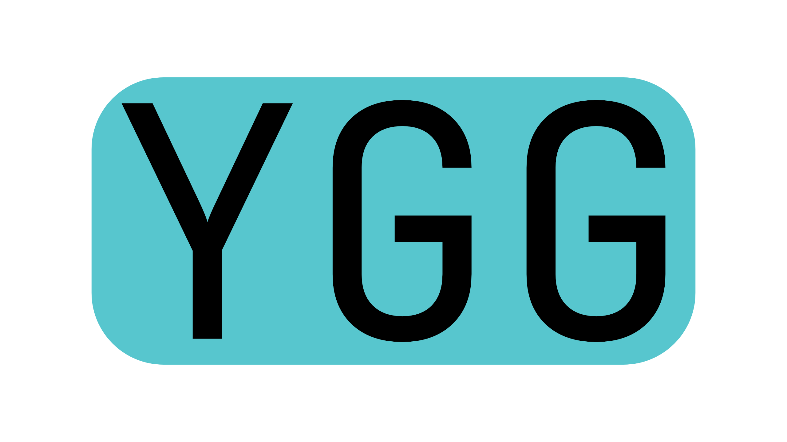

# ygg programming language
>doesnt actually work yet still WIP


custom interpreted language based on [odin](https://odin-lang.org), isnt one to one but very similar

## example
```odin

fmt          :: @import "core:fmt"
custom_files :: @import "../custom_files" // custom fils needs to be a different dir cause all files in src dir are automatically included

game_t :: struct
{
  is_running: bool,
  entities:   [dyn]entity_t,  // dynamic array
}

main :: proc( args: []string )
{
  fmt->println( "hello world" )
  
  x := 123 // auto casts to int
  x = x +2 * 3
  b := procedure( x )

  fmt->println( "b:", b )

  arg_0 : f32 = 0.5
  custom_files->custom_proc( &arg_0 )  // @UNSURE: have pointers ???

  game := game_t{ is_running=true }

  loop game.is_running 
  {
    // do stuff
    loop e, e_idx in game.entities
    {
      // do stuff to e
      loop i in 0..<10
      {
        // do something 10 times
      }
    }
  }
}

procedure :: proc( a: int ) -> bool
{
  ret : bool    // defaults to false
  if a == 129
  {
    ret = true
  }
  else
  { ret = false }
  return ret
}
```


## name
ygg or yggr meaning terrible one, which is another name for odin

## todo
  - [X] figure out name
    - muh
    - joy / joi 
    - bry / berry
    - alfodr ( meaning: all-father, different name for odin )
    - **ygg** / yggr ( meaning: terrible one, different name for odin )
      - no other meanings except maybe `You Go Girl`
      - **use this one**, bc meaning is fitting and no other meanings
    - **vak** / vakr ( meaning: wakeful, awakener, different name for odin )
      - vāk -> hindu goddess of speech
        - kinda still works but probably use `ygg` instead
      - is pronounced `fuck` [in afrikaans at least](https://en.wiktionary.org/wiki/vak) which is funny
  - [-] lexer (make tokens)
    - [ ] {, }, [, ], loop, proc etc.  
  - [ ] parser (make ast)
  - [ ] make intermediary format
  - [ ] make runtime interpreter for intermediary format

